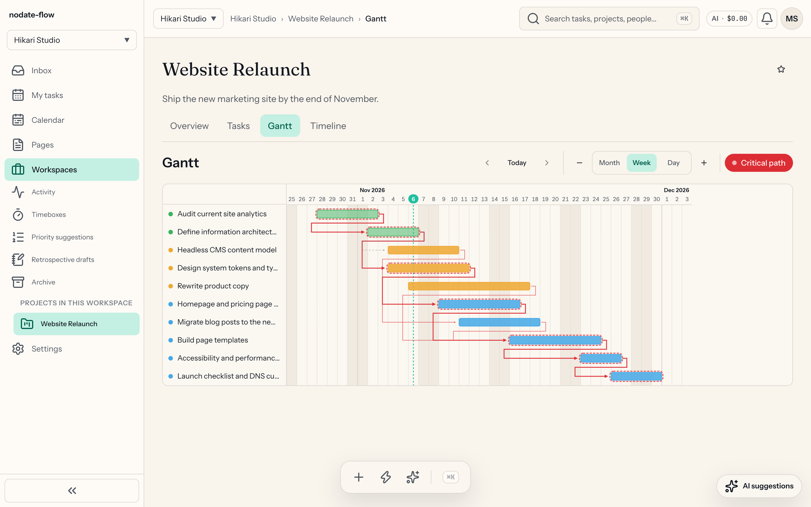
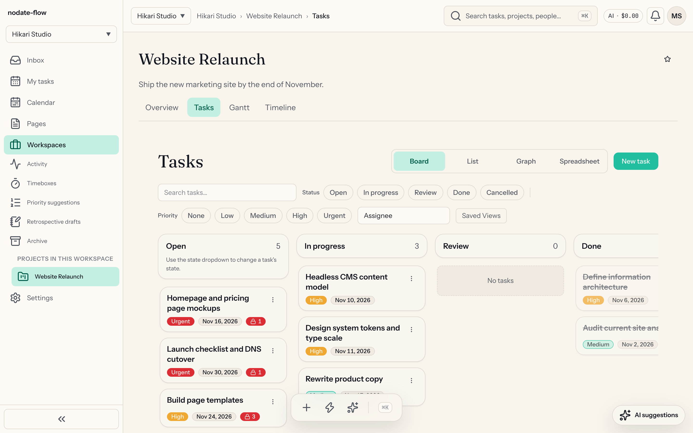
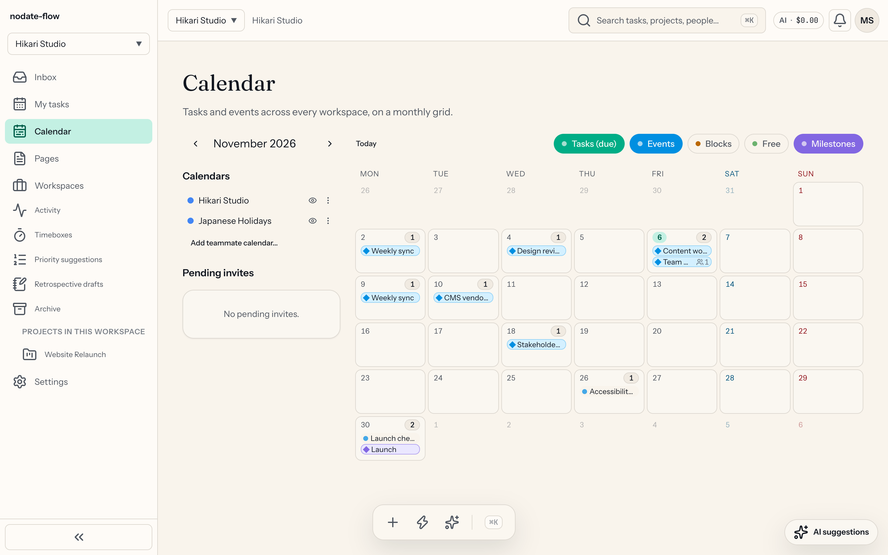

# nodate-flow

[](https://github.com/libraz/nodate-flow/actions)
[](https://codecov.io/gh/libraz/nodate-flow)
[](https://github.com/libraz/nodate-flow/blob/main/LICENSE)
[](https://go.dev/)
[](https://www.typescriptlang.org/)

**nodate-flow moves work forward on its own: a task is a process whose state follows from constraints and events, with LLMs and MCP as the execution layer.**

A self-hosted task platform built on Go, MySQL and React. Task state is never edited by hand. It derives from dependencies, constraints and an append-only event log, so every change, including the ones an LLM makes, is recorded with its actor.

📖 **[Documentation](https://github.com/libraz/nodate-flow/blob/main/docs/en/introduction.md)** &nbsp;·&nbsp; **[Getting started](#getting-started)** &nbsp;·&nbsp; **[Deployment](https://github.com/libraz/nodate-flow/blob/main/docs/en/deployment.md)**

> **Alpha, pre-1.0.** No backward compatibility is kept until v1.0, and the task schema is rebuilt rather than migrated. The project has not been independently security-audited. Report vulnerabilities through [SECURITY.md](https://github.com/libraz/nodate-flow/blob/main/SECURITY.md).



| Board                                                 | Calendar                                                                     |
| ----------------------------------------------------- | ---------------------------------------------------------------------------- |
|  |  |

## What it does

- **Derived task state** — Dependencies and constraints plus an event log decide a task's state; a database trigger rejects direct updates. [Introduction](https://github.com/libraz/nodate-flow/blob/main/docs/en/introduction.md)
- **Views and lenses** — Board, list, dependency graph and spreadsheet per project, with timeline, Gantt, dashboard widgets and read-only shared lenses.
- **Review gates** — A completion policy can require a submission that a reviewer approves, and handoffs are tracked on the task.
- **Signals and judge loop** — GitHub, Slack and Google webhooks, Discord presence, calendar days and manual notes become signals; an LLM judge proposes task events and per-workspace autonomy decides whether to suggest, draft or apply. [Introduction](https://github.com/libraz/nodate-flow/blob/main/docs/en/introduction.md) · [Architecture](https://github.com/libraz/nodate-flow/blob/main/docs/en/architecture.md)
- **AI assistance** — Smart task creation, state inference, priority insights, relation detection and natural-language commands, on OpenAI, Anthropic, Google, Ollama or any OpenAI-compatible provider. [Introduction](https://github.com/libraz/nodate-flow/blob/main/docs/en/introduction.md)
- **MCP server** — Agents and external tools read and write a workspace through scoped tokens. [Introduction](https://github.com/libraz/nodate-flow/blob/main/docs/en/introduction.md)
- **Calendar** — Shared and personal calendars with recurring events, attendees, invites, reminders, task links and public share and embed pages. [Introduction](https://github.com/libraz/nodate-flow/blob/main/docs/en/introduction.md)
- **Pages** — A tree of Markdown pages with AI-assisted drafting.
- **Inbox and intake** — Notifications with snooze, source triage that turns captured sources into tasks, a weekly digest, and live updates over server-sent events.
- **Webhooks and data** — HMAC-signed outbound webhooks, CSV and JSON export, and CSV import.
- **Accounts and access** — Argon2id passwords, OIDC sign-in with Google, GitHub and Microsoft, TOTP with recovery codes, an OIDC-only mode, and workspaces with role-based access. [Deployment](https://github.com/libraz/nodate-flow/blob/main/docs/en/deployment.md)
- **Shared database with nodate-time** — nodate-flow and the separate nodate-time calendar product can point at one MySQL and share users, groups and calendar data through a published schema contract, with no code dependency. [Introduction](https://github.com/libraz/nodate-flow/blob/main/docs/en/introduction.md) · [Architecture](https://github.com/libraz/nodate-flow/blob/main/docs/en/architecture.md)

## Getting started

Requires Go, Bun and Docker; the versions are pinned in `go.mod` and `package.json`.

```sh
git clone https://github.com/libraz/nodate-flow.git && cd nodate-flow
make dev          # MySQL (Docker) + auth-api + flow-api + accounts-web + flow-web
make seed-flow    # in a second terminal: demo admin user and workspace
```

Open <http://localhost:5173> and sign in as `admin@example.com` with the password `password123`.

| Service      | Address                                                     |
| ------------ | ----------------------------------------------------------- |
| flow-web     | <http://localhost:5173>                                     |
| accounts-web | <http://localhost:5175/accounts>                            |
| flow-api     | <http://localhost:8080> (API reference at `/api-reference`) |
| auth-api     | <http://localhost:8082>                                     |

`make dev` does not start the background worker or the Discord gateway. Run `make dev-worker` for scheduled jobs and signal retention, and `make dev-presence` for the Discord presence gateway. `make dev-reset` rebuilds the database from the schema and seeds it again.

To run nodate-flow on a server, see [Deployment](https://github.com/libraz/nodate-flow/blob/main/docs/en/deployment.md).

## Build from source

```sh
make reload       # stop the dev servers and start `make dev` fresh
make test-unit    # suites that need no container (Go -short, every TS workspace)
make test         # Go and TS tests; Go integration suites need Docker
make gen          # codegen: sqlc, errors, signal kinds, holidays, SDK
make check        # static guards: lint, formatting, typecheck, drift and repo checks
make build        # build every app
make help         # all targets
```

The repository layout and the services each target builds are listed in [Architecture](https://github.com/libraz/nodate-flow/blob/main/docs/en/architecture.md).

## Documentation

The guides live in [`docs/`](https://github.com/libraz/nodate-flow/tree/main/docs).

- **Learn** — [Introduction](https://github.com/libraz/nodate-flow/blob/main/docs/en/introduction.md) · [Architecture](https://github.com/libraz/nodate-flow/blob/main/docs/en/architecture.md)
- **Guides** — [Deployment](https://github.com/libraz/nodate-flow/blob/main/docs/en/deployment.md)
- **Reference** — HTTP API reference served by flow-api at `/api-reference` · [Contributing](https://github.com/libraz/nodate-flow/blob/main/CONTRIBUTING.md) · [Security policy](https://github.com/libraz/nodate-flow/blob/main/SECURITY.md)

## License

[AGPL-3.0](LICENSE)
