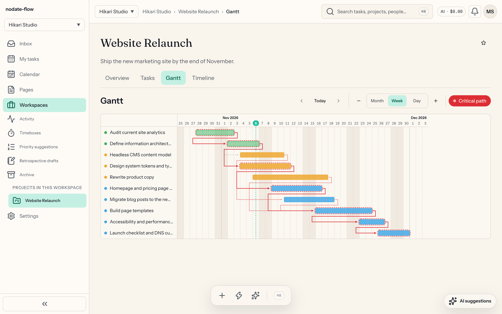
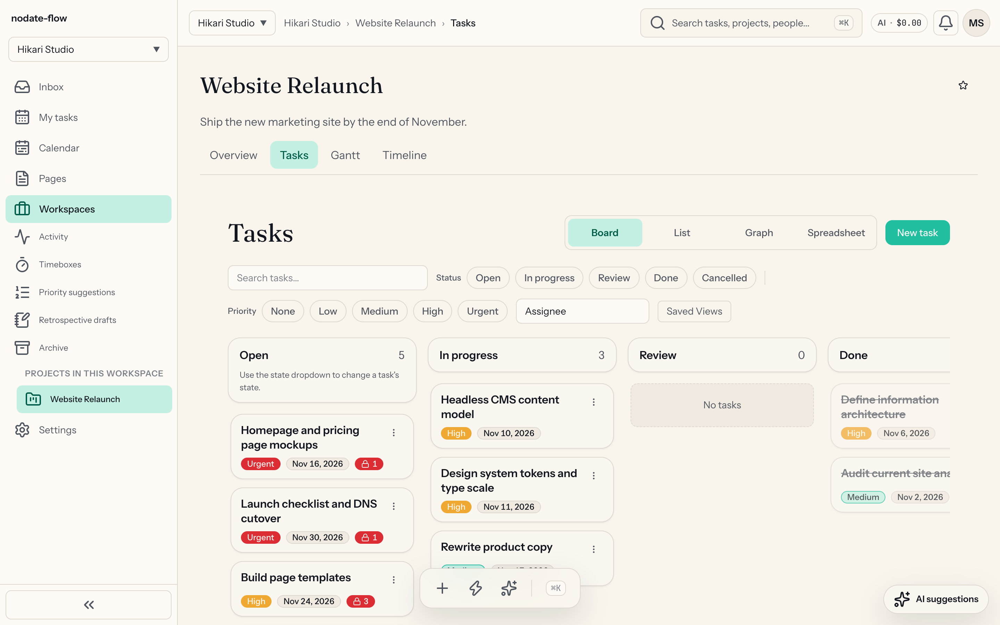
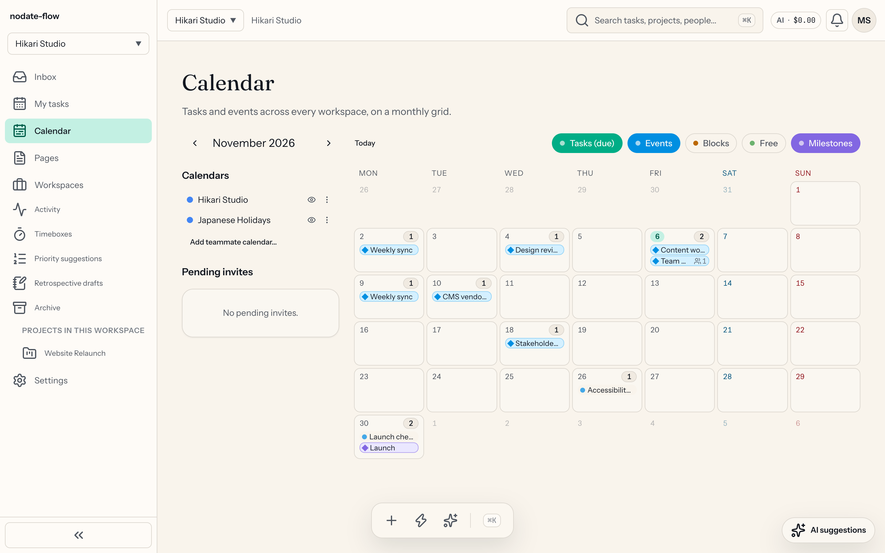

# nodate-flow

[](https://github.com/libraz/nodate-flow/actions)
[](https://codecov.io/gh/libraz/nodate-flow)
[](https://github.com/libraz/nodate-flow/blob/main/LICENSE)
[](https://go.dev/)
[](https://www.typescriptlang.org/)

**nodate-flow は、仕事の流れが勝手に前へ進むようにします。タスクは制約とイベントから状態が導出されるプロセスで、LLM と MCP がその実行層を担います。**

Go、MySQL、React で作られた自前ホスト型のタスク基盤です。タスクの状態は手で書き換えるものではなく、依存関係、制約、追記専用のイベントログから導出されます。そのため、LLM が行った変更を含むすべての変更が、行為者つきで記録されます。

📖 **[ドキュメント](https://github.com/libraz/nodate-flow/blob/main/docs/ja/introduction.md)** &nbsp;·&nbsp; **[はじめに](#はじめに)** &nbsp;·&nbsp; **[デプロイ](https://github.com/libraz/nodate-flow/blob/main/docs/ja/deployment.md)**

> **アルファ版（1.0 より前）です。** v1.0 までは後方互換性を保たず、タスク関連のスキーマは移行ではなく再構築で更新します。第三者によるセキュリティ監査は受けていません。脆弱性は [SECURITY.md](https://github.com/libraz/nodate-flow/blob/main/SECURITY.md) の手順で報告してください。



| ボード                                                 | カレンダー                                                                |
| ------------------------------------------------------ | ------------------------------------------------------------------------- |
|  |  |

## できること

- **導出されるタスク状態** — 依存関係と制約、イベントログがタスクの状態を決めます。制約はイベントを受けて評価し直され、判定が変わるたびに記録されます。直接の更新はデータベースのトリガーが拒否します。[概要](https://github.com/libraz/nodate-flow/blob/main/docs/ja/introduction.md)
- **ビューとレンズ** — プロジェクトごとのボード、リスト、依存関係グラフ、スプレッドシートに加え、タイムライン、ガント、ダッシュボードのウィジェット、すべての変更の履歴、読み取り専用で共有できるレンズ。プロジェクトはアーカイブと復元ができます。
- **レビューゲート** — 完了ポリシーで、レビュアーが承認した提出を完了の条件にできます。ハンドオフもタスクに記録されます。
- **シグナルと判定ループ** — GitHub、Slack、Google の Webhook、Discord のプレゼンス、カレンダーの当日、手動メモがシグナルになり、LLM の判定器がタスクのイベントを提案します。提案にとどめるか、下書きにするか、自動で適用するかは、ワークスペースごとの自律度が決めます。[概要](https://github.com/libraz/nodate-flow/blob/main/docs/ja/introduction.md) · [アーキテクチャ](https://github.com/libraz/nodate-flow/blob/main/docs/ja/architecture.md)
- **AI アシスト** — スマートなタスク作成、状態の推定、優先度のインサイト、タスクの埋め込みによる関連の検出、手順の提案、自然言語のコマンド。OpenAI、Anthropic、Google、Ollama（キーの有無を問わず）、OpenAI 互換のプロバイダーに対応します。[概要](https://github.com/libraz/nodate-flow/blob/main/docs/ja/introduction.md)
- **MCP サーバー** — エージェントや外部ツールが、スコープ付きのトークンでワークスペースを読み書きします。[概要](https://github.com/libraz/nodate-flow/blob/main/docs/ja/introduction.md)
- **カレンダー** — 共有・個人カレンダー、繰り返しイベント、参加者、招待、リマインダー、タスクとのリンク、公開共有と埋め込みページ。[概要](https://github.com/libraz/nodate-flow/blob/main/docs/ja/introduction.md)
- **ページ** — Markdown ページのツリーと、AI による下書き生成。
- **受信トレイと取り込み** — スヌーズ付きの通知、取り込んだソースをタスクにするトリアージ、週次ダイジェスト、Server-Sent Events によるリアルタイム更新。
- **Webhook とデータ** — HMAC 署名つきの送信 Webhook、CSV と JSON のエクスポート、CSV のインポート、タスクとカレンダーイベントの書き込みでの `Idempotency-Key`。
- **アカウントとアクセス** — Argon2id のパスワード、Google・GitHub・Microsoft の OIDC サインイン、リカバリーコード付きの TOTP、OIDC 専用モード、ロールベースのアクセス制御を持つワークスペース。プロフィール、アバター、テーマ、セッションは accounts-web で管理します。[デプロイ](https://github.com/libraz/nodate-flow/blob/main/docs/ja/deployment.md)
- **テーマ、言語、ヘルプ** — 6 つのテーマファミリー（glass、modern、washi、sakura、classic、nothing）とライト・ダーク・システム連動のモード。英語、日本語、中国語。画面ごとのヘルプとオンボーディングのチェックリスト。
- **nodate-time との共有データベース** — nodate-flow と、別プロダクトのカレンダー nodate-time は、1 つの MySQL に向けると、公開されたスキーマ契約を通してユーザー、グループ、カレンダーのデータを共有できます。コードの依存はありません。[概要](https://github.com/libraz/nodate-flow/blob/main/docs/ja/introduction.md) · [アーキテクチャ](https://github.com/libraz/nodate-flow/blob/main/docs/ja/architecture.md)

## はじめに

Go、Bun、Docker が必要です。バージョンは `mise.toml` で固定しています。

```sh
git clone https://github.com/libraz/nodate-flow.git && cd nodate-flow
make dev          # MySQL (Docker) + auth-api + flow-api + accounts-web + flow-web
make seed-flow    # 別のターミナルで実行: デモ管理ユーザーとワークスペース
```

<http://localhost:5173> を開き、`admin@example.com`、パスワード `password123` でサインインします。

| サービス     | アドレス                                                       |
| ------------ | -------------------------------------------------------------- |
| flow-web     | <http://localhost:5173>                                        |
| accounts-web | <http://localhost:5175/accounts>                               |
| flow-api     | <http://localhost:8080>（API リファレンスは `/api-reference`） |
| auth-api     | <http://localhost:8082>                                        |

`make dev` は、バックグラウンドワーカーと Discord ゲートウェイを起動しません。定期ジョブとシグナルの保持期間管理には `make dev-worker`、Discord プレゼンスのゲートウェイには `make dev-presence` を実行します。`make dev-reset` は、スキーマからデータベースを作り直し、デモデータを入れ直します。

サーバーで動かす場合は [デプロイ](https://github.com/libraz/nodate-flow/blob/main/docs/ja/deployment.md) を参照してください。

## ソースからビルド

```sh
make reload       # 開発サーバーを止めて `make dev` をやり直す
make test-unit    # コンテナ不要のテスト (Go -short と、すべての TS ワークスペース)
make test         # Go と TS のテスト。Go の統合テストには Docker が必要
make gen          # codegen: sqlc、エラー、シグナル種別、祝日、SDK
make check        # 静的チェック: lint、フォーマット、型検査、生成物とリポジトリの整合性
make build        # すべてのアプリをビルド
make help         # 全ターゲット一覧
```

リポジトリ構成と、各ターゲットがビルドするサービスは [アーキテクチャ](https://github.com/libraz/nodate-flow/blob/main/docs/ja/architecture.md) にまとめています。

## ドキュメント

ガイドは [`docs/`](https://github.com/libraz/nodate-flow/tree/main/docs) にあります。

- **学ぶ** — [概要](https://github.com/libraz/nodate-flow/blob/main/docs/ja/introduction.md) · [アーキテクチャ](https://github.com/libraz/nodate-flow/blob/main/docs/ja/architecture.md)
- **ガイド** — [デプロイ](https://github.com/libraz/nodate-flow/blob/main/docs/ja/deployment.md)
- **リファレンス** — flow-api が `/api-reference` で配信する HTTP API リファレンス · [コントリビュート](https://github.com/libraz/nodate-flow/blob/main/CONTRIBUTING.md)（英語） · [セキュリティポリシー](https://github.com/libraz/nodate-flow/blob/main/SECURITY.md)

## ライセンス

[AGPL-3.0](LICENSE)
