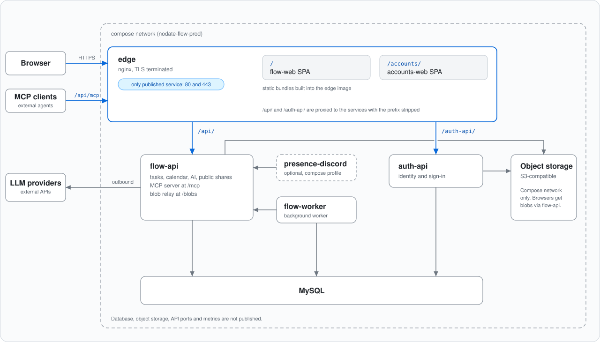
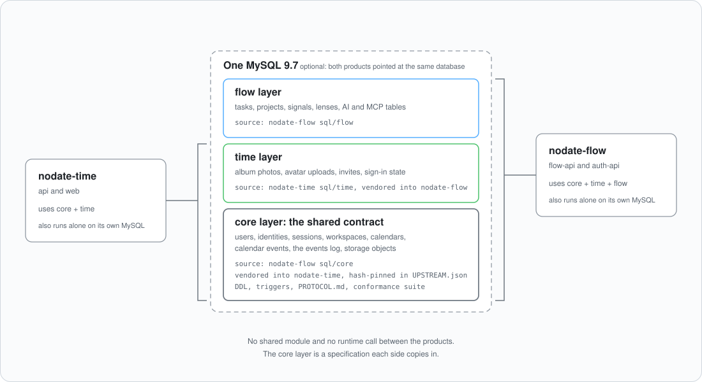

# Architecture

nodate-flow is a set of Go services and two React apps over one MySQL database. `flow-api` is the product backend: tasks, calendar, AI, MCP and public shares live in that one binary. `auth-api` owns identity.

## Runtime topology



`compose.prod.yml` publishes one container, the edge. It terminates TLS and routes by path on a single hostname: `/` to flow-web, `/accounts/` to accounts-web, `/api/` to flow-api and `/auth-api/` to auth-api. Everything else stays on the compose network.

| Service          | Role                                                                                                                                                                             | Talks to                             |
| ---------------- | -------------------------------------------------------------------------------------------------------------------------------------------------------------------------------- | ------------------------------------ |
| edge             | nginx. TLS, path routing, both SPAs, security headers. The only published ports (80, 443).                                                                                       | flow-api, auth-api                   |
| auth-api         | Sign-in, sessions, OIDC, TOTP and recovery codes, workspace integrations' OAuth, instance administration.                                                                        | MySQL, object storage                |
| flow-api         | Tasks, calendar, AI, MCP server, public shares, webhooks, import and export, the server-sent event stream, the `/blobs` relay, and the OpenAPI document with its reference page. | MySQL, object storage, LLM providers |
| flow-worker      | Scheduled jobs: calendar event-day signals, signal retention, business metrics. Runs as a single instance.                                                                       | MySQL, flow-api                      |
| presence-discord | Optional, started with the `presence-discord` profile. Holds one Discord gateway connection and forwards presence changes. Has no database connection.                           | flow-api                             |
| mysql            | The only datastore for rows and the event log.                                                                                                                                   |                                      |
| storage          | S3-compatible gateway for attachments and avatars. Browsers reach it only through flow-api's `/blobs` relay.                                                                     |                                      |

flow-worker connects to MySQL itself and to flow-api with a shared service token. presence-discord does not touch the database: it looks up the flow user for a Discord account and posts signals, both over HTTP to flow-api, so a compromised gateway is bounded by what that token allows.

Task embeddings are stored as 768-dimensional vectors in MySQL. For similarity suggestions, the database selects up to 200 recent tasks that match the workspace and embedding model and that the caller can read. flow-api ranks that candidate set by cosine similarity. Older tasks outside the candidate set are excluded. MySQL Community provides vector storage. The native vector distance function is available in HeatWave and MySQL AI. [MySQL vector functions](https://dev.mysql.com/doc/refman/26.10/en/vector-functions.html)

By default flow-api keeps its event stream and its outbound rate limiter in process, which assumes one replica. Setting `NF_FLOW_STREAM_BACKEND` and `NF_FLOW_OUTBOUND_BACKEND` to `redis` moves both to a Redis-compatible store shared by replicas. The stream also tails the `events` table (`NF_FLOW_STREAM_TAIL`, on by default), so changes written by another process reach connected clients.

The development compose file adds a Redis-compatible store, a mail catcher, an OpenTelemetry collector, Prometheus and Grafana. Their configuration is under `infra/`.

### How a change reaches the screen

A write appends a row to the `events` table in the same transaction as the state change. flow-api fans the event out over server-sent events, and flow-web refreshes the queries that event affects. Task state is derived from those events, and a database trigger refuses direct updates to `derived_state`.

## Shared database



The database schema is built from three layers by `sql/core/tools/build-schema.sh` and written to `sql/schema.sql`.

| Layer | Directory   | Contents                                                                                                                                                                                       |
| ----- | ----------- | ---------------------------------------------------------------------------------------------------------------------------------------------------------------------------------------------- |
| core  | `sql/core/` | Workspaces, members, users, identities, sessions, calendars and events, the `events` log, storage objects, audit. Also the protocol document, conformance suite, upgrades and vendoring tools. |
| time  | `sql/time/` | Tables and views owned by nodate-time, vendored from its repository and pinned to a commit with per-file hashes.                                                                               |
| flow  | `sql/flow/` | Tasks, projects, AI settings and runs, MCP tokens, signals, lenses, timeboxes, and the rest of the task product.                                                                               |

nodate-time is a separate product with its own repository and deployment. When both run against one database, they share users, groups and calendar data without sharing code: the shared artifact is the core schema plus the written protocol in `sql/core/PROTOCOL.md`. A product that implements it writes `calendar_events` as the DDL specifies, appends one `events` row in the same transaction, leaves rows linked to a task alone, and follows the session-variable protocol for guarded writes. Database triggers enforce the guarded parts, and the conformance suite in `sql/core/conformance/` checks both products against the same assertions.

nodate-time's `calendars` correspond to `workspaces` here, not to this repository's `calendars`. Each product keeps its own sign-in implementation under the identity rules in the protocol, and sessions are separated by audience.

A product layer never alters the shape of a core table. A database holding only core and time can gain the flow layer by applying it alone.

## Repository layout

```
apps/
  flow-api/          # Go: tasks, calendar, AI, MCP, public shares, SSE (Huma + chi + sqlc)
  flow-worker/       # Go: scheduled jobs (event-day signals, signal retention, metrics)
  presence-discord/  # Go: Discord gateway client; talks to flow-api over HTTP only
  auth-api/          # Go: identity, sessions, OIDC, TOTP, administration
  flow-web/          # React: tasks, calendar, inbox, pages, public shares
  accounts-web/      # React: sign-in, sign-up, account and administration UI
  cli/               # TypeScript CLI (binary: tnk)
packages/
  go-shared/         # Go packages shared by the services (event log, auth, crypto, ACL)
  sdk/               # TypeScript SDK generated from the OpenAPI document
  ui/                # Design system and themes
  i18n-shared/       # Common-namespace strings shared by both web apps
  holidays/          # Holiday data, also embedded into the Go services
errors/              # Error code definitions (YAML)
signal_kinds/        # Signal kind definitions (YAML)
sql/                 # core, time and flow schema layers, sqlc queries, schema.sql
infra/               # Edge (nginx), Prometheus, Grafana, OpenTelemetry
scripts/             # Code generators and repository checks
```

## Generated code

Four sources of truth feed generated code, and `make gen` regenerates all of it.

- `sql/` and `sql/queries/` produce the sqlc Go packages under each service's `internal/db/generated/`.
- `errors/*.yaml` produces Go and TypeScript error modules, locale stubs and error documentation.
- `signal_kinds/*.yaml` produces Go and TypeScript signal-kind modules, locale stubs and documentation.
- The Go handlers produce the merged OpenAPI document, from which `packages/sdk` generates its types.

`make verify-codegen` fails when any of these is out of sync with its source.
