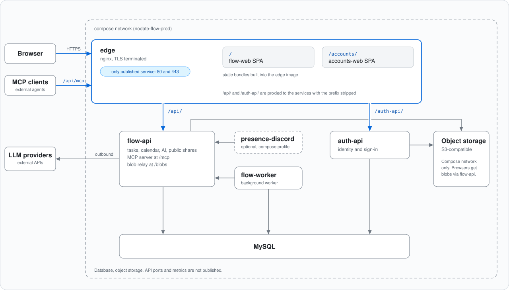
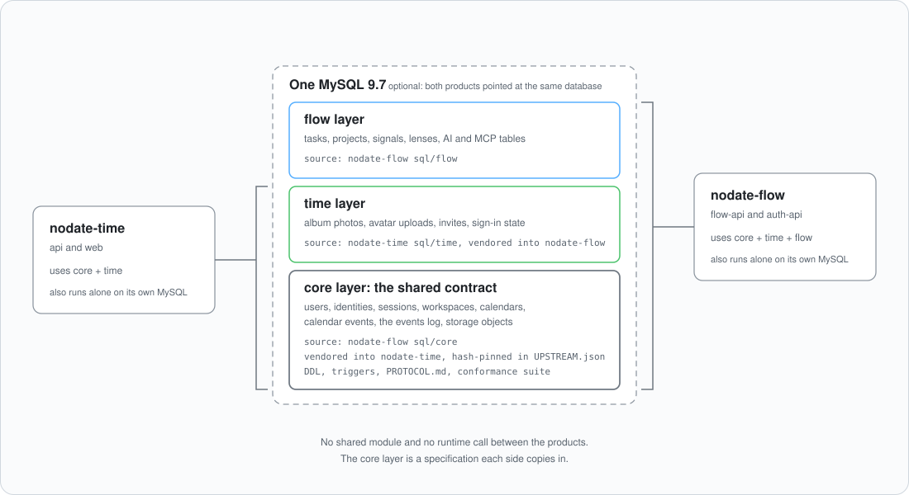

# アーキテクチャ

nodate-flow は、1 つの MySQL データベースの上で動く Go のサービス群と 2 つの React アプリで構成されます。`flow-api` がプロダクトのバックエンドで、タスク、カレンダー、AI、MCP、公開共有を 1 つのバイナリで提供します。`auth-api` は ID 管理を担当します。

## ランタイム構成



`compose.prod.yml` が公開するコンテナは edge だけです。edge は TLS を終端し、1 つのホスト名の中でパスによって振り分けます。`/` は flow-web、`/accounts/` は accounts-web、`/api/` は flow-api、`/auth-api/` は auth-api です。それ以外はすべて compose ネットワークの内側にとどまります。

| サービス         | 役割                                                                                                                                                                              | 接続先                                          |
| ---------------- | --------------------------------------------------------------------------------------------------------------------------------------------------------------------------------- | ----------------------------------------------- |
| edge             | nginx。TLS、パスによる振り分け、2 つの SPA、セキュリティヘッダー。公開する唯一のポート（80、443）。                                                                               | flow-api、auth-api                              |
| auth-api         | サインイン、セッション、OIDC、TOTP とリカバリーコード、ワークスペース連携の OAuth、インスタンス管理。                                                                             | MySQL、オブジェクトストレージ                   |
| flow-api         | タスク、カレンダー、AI、MCP サーバー、公開共有、Webhook、インポートとエクスポート、Server-Sent Events のストリーム、`/blobs` 中継、OpenAPI ドキュメントとそのリファレンスページ。 | MySQL、オブジェクトストレージ、LLM プロバイダー |
| flow-worker      | 定期ジョブ。カレンダーの当日シグナル、シグナルの保持期間管理、業務メトリクス。単一インスタンスで動かします。                                                                      | MySQL、flow-api                                 |
| presence-discord | 任意。`presence-discord` プロファイルで起動します。Discord ゲートウェイへの接続を 1 本持ち、プレゼンスの変化を転送します。データベースには接続しません。                          | flow-api                                        |
| mysql            | 行とイベントログを保存する唯一のデータストア。                                                                                                                                    |                                                 |
| storage          | 添付ファイルとアバター用の S3 互換ゲートウェイ。ブラウザからは flow-api の `/blobs` 中継経由でしか到達できません。                                                                |                                                 |

flow-worker は MySQL に直接接続し、flow-api へは共有のサービストークンで接続します。presence-discord はデータベースに触れません。Discord アカウントに対応する flow ユーザーの照会とシグナルの送信を、どちらも flow-api への HTTP で行います。そのため、ゲートウェイが侵害されても影響はこのトークンで許可された範囲に限られます。

flow-api は既定でイベントストリームと送信レートリミッターをプロセス内に持つため、レプリカは 1 つを前提にしています。`NF_FLOW_STREAM_BACKEND` と `NF_FLOW_OUTBOUND_BACKEND` を `redis` にすると、両方がレプリカ間で共有される Redis 互換ストアに移ります。ストリームは `events` テーブルの追跡も行い（`NF_FLOW_STREAM_TAIL`、既定で有効）、別のプロセスが書き込んだ変更も接続中のクライアントに届きます。

開発用の compose ファイルには、Redis 互換ストア、メールキャッチャー、OpenTelemetry コレクター、Prometheus、Grafana が加わります。設定は `infra/` にあります。

### 変更が画面に届くまで

書き込みは、状態の変更と同じトランザクションで `events` テーブルに 1 行を追加します。flow-api はそのイベントを Server-Sent Events で配信し、flow-web は影響を受けるクエリを再取得します。タスクの状態はこれらのイベントから導出され、`derived_state` を直接更新しようとするとデータベースのトリガーが拒否します。

## 共有データベース



データベースのスキーマは `sql/core/tools/build-schema.sh` が 3 つの層から組み立て、`sql/schema.sql` に書き出します。

| 層   | ディレクトリ | 内容                                                                                                                                                                                               |
| ---- | ------------ | -------------------------------------------------------------------------------------------------------------------------------------------------------------------------------------------------- |
| core | `sql/core/`  | ワークスペース、メンバー、ユーザー、identities、セッション、カレンダーとイベント、`events` ログ、ストレージオブジェクト、監査。プロトコル文書、適合性テスト、upgrade、vendoring ツールも含みます。 |
| time | `sql/time/`  | nodate-time が持つテーブルとビュー。nodate-time のリポジトリから vendoring し、コミットとファイル単位のハッシュで固定します。                                                                      |
| flow | `sql/flow/`  | タスク、プロジェクト、AI の設定と実行、MCP トークン、シグナル、レンズ、タイムボックスなど、タスクプロダクトのテーブル。                                                                            |

nodate-time は、独自のリポジトリとデプロイを持つ別のプロダクトです。両方を 1 つのデータベースに向けると、コードを共有せずにユーザー、グループ、カレンダーのデータを共有できます。共有するのは core スキーマと `sql/core/PROTOCOL.md` に書かれたプロトコルだけです。プロトコルを実装するプロダクトは、DDL の定めどおりに `calendar_events` を書き、同じトランザクションで `events` に 1 行を追加し、タスクに紐づく行には手を加えず、保護された書き込みではセッション変数のプロトコルに従います。保護される部分はデータベースのトリガーが強制し、`sql/core/conformance/` の適合性テストが両方のプロダクトを同じ検証で確認します。

nodate-time の `calendars` は、このリポジトリの `calendars` ではなく `workspaces` に対応します。サインインの実装はプロダクトごとに持ち、プロトコルの ID 規則に従います。セッションは audience で分離されます。

プロダクト層が core のテーブルの形を変えることはありません。core と time だけのデータベースには、flow 層を単独で適用して加えられます。

## リポジトリ構成

```
apps/
  flow-api/          # Go: タスク、カレンダー、AI、MCP、公開共有、SSE (Huma + chi + sqlc)
  flow-worker/       # Go: 定期ジョブ (当日シグナル、シグナル保持期間、メトリクス)
  presence-discord/  # Go: Discord ゲートウェイクライアント。flow-api とは HTTP でのみ通信
  auth-api/          # Go: ID 管理、セッション、OIDC、TOTP、管理機能
  flow-web/          # React: タスク、カレンダー、受信トレイ、ページ、公開共有
  accounts-web/      # React: サインイン、サインアップ、アカウントと管理の UI
  cli/               # TypeScript 製 CLI (バイナリ名: tnk)
packages/
  go-shared/         # サービス間で共有する Go パッケージ (イベントログ、認証、暗号、ACL)
  sdk/               # OpenAPI ドキュメントから生成する TypeScript SDK
  ui/                # デザインシステムとテーマ
  i18n-shared/       # 2 つの Web アプリで共有する common 名前空間の文言
  holidays/          # 祝日データ。Go のサービスにも埋め込まれます
errors/              # エラーコード定義 (YAML)
signal_kinds/        # シグナル種別の定義 (YAML)
sql/                 # core、time、flow のスキーマ層、sqlc クエリ、schema.sql
infra/               # edge (nginx)、Prometheus、Grafana、OpenTelemetry
scripts/             # コード生成と、リポジトリの整合性チェック
```

## 生成コード

生成コードの一次ソースは 4 つあり、`make gen` がすべて再生成します。

- `sql/` と `sql/queries/` から、各サービスの `internal/db/generated/` に sqlc の Go パッケージを生成します。
- `errors/*.yaml` から、Go と TypeScript のエラーモジュール、ロケールのスタブ、エラーのドキュメントを生成します。
- `signal_kinds/*.yaml` から、Go と TypeScript のシグナル種別モジュール、ロケールのスタブ、ドキュメントを生成します。
- Go のハンドラーから、統合した OpenAPI ドキュメントを生成し、そこから `packages/sdk` が型を生成します。

`make verify-codegen` は、これらのいずれかが一次ソースと食い違っていると失敗します。
